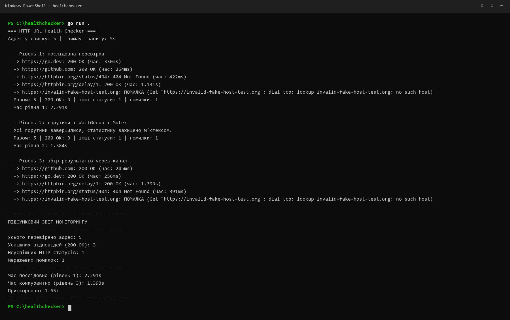
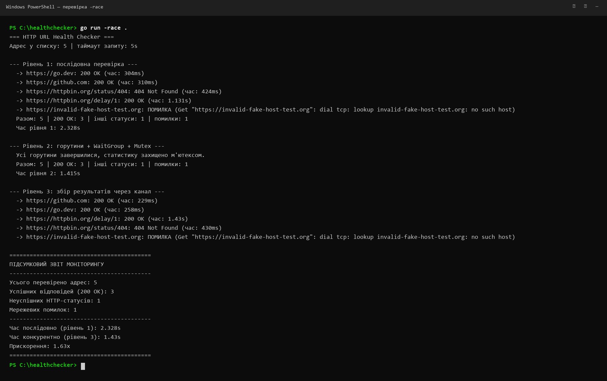
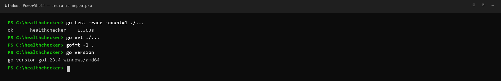

# Практична робота № 1

## HTTP URL Health Checker

**Тема:** Базові конструкції, структури даних та конкурентність у Go

**Виконав:** студент Zhuma5

**Середовище:** Windows, Go 1.23.4, Visual Studio Code

---

## 1. Мета роботи

- попрактикуватися зі структурами, методами та явним опрацюванням помилок у Go;
- розібратися, як працюють інтерфейси та неявна (структурна) реалізація;
- порівняти послідовне й конкурентне виконання запитів;
- закріпити `goroutine`, `sync.WaitGroup`, `sync.Mutex` і канали;
- перевірити програму детектором гонок `-race`.

---

## 2. Що робить програма

Консольна утиліта перевіряє доступність п'яти HTTP-адрес. Для кожної адреси вона показує:

- HTTP-статус (або текст помилки);
- тривалість запиту;
- загальну статистику: скільки адрес перевірено, скільки відповіли `200 OK`, скільки мали інший статус і скільки завершилися мережевою помилкою.

Список адрес:

| № | URL | Навіщо він у списку |
|---|-----|---------------------|
| 1 | `https://go.dev` | реальний сайт, очікуємо 200 |
| 2 | `https://github.com` | реальний сайт, очікуємо 200 |
| 3 | `https://httpbin.org/status/404` | перевірка невдалого HTTP-статусу |
| 4 | `https://httpbin.org/delay/1` | повільна відповідь, добре показує перевагу паралельності |
| 5 | `https://invalid-fake-host-test.org` | неіснуючий домен, перевірка помилки з'єднання |

Програма послідовно проходить три рівні:

1. **Рівень 1** — звичайний цикл, запити один за одним.
2. **Рівень 2** — окрема горутина на кожен URL, спільна статистика під `sync.Mutex`.
3. **Рівень 3** — результати передаються через канал, підрахунок робить лише головна горутина.

Після цього виводиться підсумковий звіт і порівняння часу послідовного та конкурентного варіантів.

---

## 3. Архітектура проєкту

### 3.1. Структура файлів

```text
.
├── main.go          # список URL, запуск рівнів, підсумковий звіт
├── checker.go       # CheckResult, інтерфейс Checker, HTTPChecker
├── sequential.go    # рівень 1: послідовна перевірка
├── mutex.go         # рівень 2: goroutine + WaitGroup + Mutex
├── channels.go      # рівень 3: goroutine + канал + close
├── stats.go         # StatsValues і потокобезпечний Stats
├── output.go        # функції виводу
├── checker_test.go  # тести HTTPChecker
├── stats_test.go    # тест спільної статистики під навантаженням
├── monitor_test.go  # тести рівнів 2 і 3
├── go.mod
├── README.md
└── docs/
    ├── logs/        # текстові логи запусків
    └── screenshots/ # скриншоти консолі
```

Проєкт навмисно зроблений в одному пакеті `main`: це невелика лабораторна, і розносити три рівні по окремих пакетах було б зайвим ускладненням. Але логіка вже розділена по файлах, тому за потреби кожен рівень можна винести в окремий пакет майже без змін.

### 3.2. Схема

```text
                         +----------------------+
                         |   Checker (interface)|
                         | Check(string) Result |
                         +----------+-----------+
                                    ^
                                    | неявно реалізує
                         +----------+-----------+
                         |     HTTPChecker      |
                         | http.Client, timeout |
                         +----------+-----------+
                                    ^
                                    |
        +---------------------------+---------------------------+
        |                           |                           |
  runSequential              runWithMutex               runWithChannels
  (рівень 1)                 (рівень 2)                 (рівень 3)
        |                           |                           |
        +---------------------------+---------------------------+
                                    |
                                 main.go
                         (запускає всі рівні, друкує звіт)
```

### 3.3. Контракт і реалізація

У [checker.go](checker.go) є структура результату:

```go
type CheckResult struct {
	URL        string
	StatusCode int
	Duration   time.Duration
	Err        error
}
```

Інтерфейс `Checker` описує лише одну дію:

```go
type Checker interface {
	Check(url string) CheckResult
}
```

`HTTPChecker` ніде не пише, що він реалізує `Checker`. Компілятор сам перевіряє це за набором методів. Для надійності доданий рядок:

```go
var _ Checker = (*HTTPChecker)(nil)
```

Він нічого не робить під час виконання, але не дасть змінити сигнатуру `Check` і забути про контракт.

`HTTPChecker` всередині має `*http.Client` з таймаутом. Час вимірюється так:

```go
start := time.Now()
resp, err := c.client.Get(url)
res.Duration = time.Since(start)
```

Тобто в тривалість входить встановлення з'єднання й очікування заголовків відповіді. Тіло вже після вимірювання дочитується через `io.Copy(io.Discard, resp.Body)`, щоб з'єднання повернулося в пул, а не просто обірвалося.

### 3.4. Рівень 1: послідовний цикл

Функція `runSequential` приймає інтерфейс `Checker`, а не конкретний `HTTPChecker`. Це дозволяє підмінити реалізацію в тестах і показує залежність від абстракції, а не від деталей.

Час рівня 1 — це сума часу всіх запитів, бо наступний запит починається лише після завершення попереднього.

### 3.5. Рівень 2: WaitGroup і Mutex

`runWithMutex` запускає по горутині на кожен URL:

```go
wg.Add(1)
go func(url string) {
	defer wg.Done()
	stats.Add(checker.Check(url))
}(url)
```

Важливі моменти:

- `wg.Add(1)` стоїть **до** `go`, інакше `wg.Wait()` може побачити нульовий лічильник і завершитися раніше, ніж горутина взагалі почне роботу.
- URL передається параметром, а не захоплюється із циклу. У Go 1.22+ змінна циклу вже створюється заново на кожній ітерації, але явна передача зрозуміліша і працює в будь-якій версії.
- `defer wg.Done()` гарантує зменшення лічильника навіть при достроковому виході з функції.

Спільна статистика описана в [stats.go](stats.go). `Stats` містить `sync.Mutex` і `StatsValues`. Метод `Add` бере `Lock` на весь час оновлення лічильників:

```go
func (s *Stats) Add(r CheckResult) {
	s.mu.Lock()
	defer s.mu.Unlock()
	s.values.Add(r)
}
```

`Snapshot` повертає копію `StatsValues` без м'ютекса. Це важливо: якби функція повертала `Stats` за значенням, разом із ним скопіювався б і `sync.Mutex`, а копіювати замок не можна.

### 3.6. Рівень 3: канал і координатор

У [channels.go](channels.go) спільної статистики вже немає. Є небуферизований канал `resultsCh`:

1. Для кожного URL створюється горутина, яка після перевірки робить `resultsCh <- checker.Check(url)`.
2. Окрема горутина-координатор викликає `wg.Wait()` і після цього `close(resultsCh)`.
3. Головна горутина читає канал через `for res := range resultsCh` і сама оновлює локальні `StatsValues`.

Схема життєвого циклу:

```text
main ── запускає N горутин ──> [goroutine 1] ──┐
                               [goroutine 2] ──┼──> resultsCh ──> main (range)
                               [goroutine N] ──┘
                                      │
                               wg.Done() (defer)
                                      │
                              coordinator: wg.Wait() -> close(resultsCh)
```

Чому канал закриває саме координатор:

- закривати канал можна лише після завершення всіх відправлень;
- якби кожна горутина закривала канал, була б паніка `close of closed channel`;
- якщо закрити канал до завершення всіх горутин, вони отримали б паніку під час відправлення.

Координатор не є відправником, але він дочекався `wg.Wait()` і тому точно знає, що відправляти вже нікому. Це безпечний спосіб закрити канал ззовні групи горутин.

У рівні 3 підрахунок виконується лише в головній горутині, тому м'ютекс не потрібен взагалі. Це і є основна ідея CSP: «не спілкуйтеся, розділяючи пам'ять; натомість діліться пам'яттю, спілкуючись».

### 3.7. Чому результати сортуються

Порядок надходження результатів із каналу залежить від того, який запит завершився першим. Для стабільного вигляду звіту `main` сортує результати за URL перед друком. На логіку підрахунку це не впливає: статистика вже зібрана.

### 3.8. Порівняння часу

Кожен рівень отримує новий `HTTPChecker` з окремим `Transport`, тому рівні не діляться вже відкритими keep-alive з'єднаннями. Це робить порівняння трохи чеснішим.

Прискорення рахується як:

```go
speedup := float64(sequential) / float64(concurrent)
```

Воно не буде рівним кількості адрес, бо конкурентний час обмежений найповільнішим запитом, а не сумою. У нашому запуску найповільнішим був `httpbin.org/delay/1` (близько 1.1–1.4 с), тому прискорення вийшло приблизно 1.6–1.7×, а не 5×.

---

## 4. Запуск

Потрібен Go 1.22 або новіший.

```bash
# з кореня проєкту
go mod download   # зовнішніх залежностей немає, команда необов'язкова

# звичайний запуск
go run .

# запуск із детектором гонок
go run -race .

# тести з детектором гонок
go test -race -count=1 ./...

# статична перевірка та форматування
go vet ./...
gofmt -l .
```

Якщо `gofmt -l .` нічого не виводить — усі файли відформатовані. Якщо `go vet ./...` нічого не виводить — зауважень немає.

### Примітка для Windows про `-race`

На Windows детектор гонок Go потребує 64-бітного C-компілятора (cgo). Якщо `go run -race .` падає з повідомленням на кшталт `cgo: C compiler "gcc" not found` або `cc1.exe: 64-bit mode not compiled in`, потрібно встановити саме 64-бітний MinGW-w64 (наприклад, MSYS2 або w64devkit) і додати його `bin` у `PATH`.

```powershell
# приклад, якщо gcc лежить у MSYS2
$env:CC = "C:\msys64\mingw64\bin\gcc.exe"
go run -race .
```

Старий 32-бітний MinGW із mingw.org для `-race` не підходить. На Linux/macOS достатньо звичайних build tools.

---

## 5. Результати запуску

Нижче — один із реальних запусків (час залежить від мережі, тому цифри щоразу трохи інші).

| URL | Статус | Час |
|-----|--------|-----|
| `https://go.dev` | 200 OK | 330 ms |
| `https://github.com` | 200 OK | 264 ms |
| `https://httpbin.org/status/404` | 404 Not Found | 422 ms |
| `https://httpbin.org/delay/1` | 200 OK | 1.131 s |
| `https://invalid-fake-host-test.org` | помилка DNS | — |

Підсумок:

```text
Усього перевірено адрес: 5
Успішних відповідей (200 OK): 3
Неуспішних HTTP-статусів: 1
Мережевих помилок: 1

Час послідовно (рівень 1): 2.291s
Час конкурентно (рівень 3): 1.393s
Прискорення: 1.65x
```

Повний текст: [docs/logs/run.txt](docs/logs/run.txt).

---

## 6. Скриншоти

Нижче — зображення консольного виводу, зібрані з реальних логів цього запуску. Щоб рядок уміщався у вікно, шлях у запрошенні скорочено до `C:\healthchecker`; сам вивід програми не редагувався. За потреби ці зображення можна замінити на власні скриншоти — текстовий вивід лежить у [docs/logs](docs/logs).

### 6.1. Повний запуск програми



### 6.2. Перевірка `go run -race .`



У виводі немає жодного `WARNING: DATA RACE`. Повний лог: [docs/logs/race.txt](docs/logs/race.txt).

### 6.3. Тести, `go vet` і `gofmt`



Порожній вивід після `go vet ./...` і `gofmt -l .` означає, що зауважень немає. Повний лог: [docs/logs/tests.txt](docs/logs/tests.txt).

---

## 7. Тести

| Тест | Що перевіряє |
|------|--------------|
| `TestHTTPCheckerStatusCodes` | статуси 200 і 404, заповнення URL, додатну тривалість |
| `TestHTTPCheckerConnectionError` | закритий порт дає помилку, статус залишається 0 |
| `TestHTTPCheckerTimeout` | повільний сервер переривається таймаутом клієнта |
| `TestCheckResultOK` | метод `OK()` правильно розрізняє 200, 404 і помилку |
| `TestStatsConcurrentAdd` | 300 горутин одночасно оновлюють `Stats`, лічильники не губляться |
| `TestRunWithMutexAndChannels` | рівні 2 і 3 дають однакову статистику на однакових URL |

`TestStatsConcurrentAdd` особливо корисний разом із `-race`: якщо прибрати `Lock`/`Unlock` у `Stats.Add`, детектор гонок це побачить.

Запуск:

```text
ok  healthchecker  1.363s
```

---

## 8. Висновки

- Інтерфейс `Checker` дозволив відв'язати логіку перевірки від конкретного HTTP-клієнта. Рівні 1–3 працюють з абстракцією, тому їх можна тестувати й замінювати реалізацію без переписування.
- Послідовний варіант простий, але час виконання дорівнює сумі часів усіх запитів. Конкурентний варіант обмежений найповільнішим запитом, тому на п'яти адресах із однією повільною відповіддю вдалося отримати приблизно 1.6–1.7× прискорення.
- `sync.WaitGroup` зручно використовувати для очікування групи горутин, але `Add` обов'язково має бути до `go`.
- `sync.Mutex` розв'язує проблему спільних лічильників, але робить горутини залежними від спільного стану. Варіант із каналом вийшов простішим для розуміння: кожна горутина лише надсилає результат, а вся агрегація відбувається в одному місці.
- Канал закривають лише після завершення всіх відправлень. У роботі це робить окремий координатор після `wg.Wait()`.
- `go run -race .` і `go test -race ./...` не показали гонок. Це підтверджує, що критичні секції та передача даних через канал організовані правильно.

Що можна покращити далі: додати `context.Context` для скасування, повторні спроби для тимчасових помилок, обмеження кількості одночасних запитів (worker pool), винесення списку URL у конфігураційний файл і вивід результату в JSON.

---

## 9. Короткі відповіді на контрольні питання

1. **Неявна реалізація інтерфейсів у Go vs `implements` у Java/C#.** У Go достатньо, щоб тип мав усі методи інтерфейсу; ніде не треба писати `implements`. Інтерфейс може бути оголошений навіть у пакеті-споживачі, і це не потребує зміни типу-реалізації. У Java/C# зв'язок явний і перевіряється за іменем. Плюс Go — менша зв'язаність і легше тестування, мінус — можна випадково задовольнити чужий інтерфейс, а помилку іноді видно лише при присвоєнні.

2. **Value receiver vs pointer receiver.** `func (t T)` отримує копію, тому не може змінити оригінал; `func (t *T)` працює з оригіналом і може його змінювати. У методний набір `T` входять лише методи з value receiver, а в набір `*T` — і value, і pointer. Тому якщо метод має pointer receiver, інтерфейс задовольняє `*T`, але не `T`. Для великих структур, м'ютексів і зміни стану беруть pointer receiver.

3. **Чому 1000 горутин не вбивають пам'ять.** Горутина починається зі стека приблизно 2 КБ і росте за потреби; планувальник Go (GMP) сам розкладає горутини по невеликій кількості потоків ОС. Перемикання між горутинами дешевше, бо відбувається в просторі користувача. Потік ОС має стек у кілька мегабайт і перемикається через ядро, тому 1000 потоків — це вже гігабайти та великі накладні витрати.

4. **Стан гонитви (race condition).** Це ситуація, коли результат залежить від того, в якому порядку горутини звернулися до спільних даних, і хоча б один із доступів є записом без синхронізації. Прапорець `-race` додає інструментацію до звернень до пам'яті й перевіряє відношення «happens-before»; якщо два доступи не впорядковані, детектор друкує `WARNING: DATA RACE` зі стеками обох сторін. Він знаходить лише ті гонки, які реально відбулися під час запуску, і помітно сповільнює програму.

5. **Навіщо `sync.WaitGroup` і чому `Add` до `go`.** `WaitGroup` — це лічильник активних задач: `Add` збільшує його, `Done` зменшує, `Wait` блокує горутину, поки лічильник не стане нулем. Якщо викликати `Add` після `go`, горутина може встигнути виконати `Done` раніше, лічильник стане від'ємним (паніка) або `Wait` побачить нуль і повернеться, не дочекавшись роботи.

6. **`sync.Mutex` vs канал.** М'ютекс — це спільна пам'ять плюс замок: горутини по черзі заходять у критичну секцію. Канал — це передача значень і одночасно синхронізація: дані «переїжджають» від відправника до отримувача, і спільного стану може не бути взагалі. М'ютекс зручний для лічильників і кешів, канал — для координації, конвеєрів і передачі володіння даними. У роботі рівень 2 використовує м'ютекс, а рівень 3 — канал.

7. **Що буде із закритим каналом.** Надсилання в закритий канал викликає паніку `send on closed channel`; повторне закриття — паніку `close of closed channel`; закриття `nil`-каналу — теж паніку. Читання із закритого каналу не блокує: воно одразу повертає нульове значення, а `v, ok := <-ch` дає `ok == false`. Тому канал закриває лише відправник, і лише тоді, коли всі відправлення вже завершені.

---

## 10. Джерела

- Офіційна документація Go: <https://go.dev/doc/>
- `sync`: <https://pkg.go.dev/sync>
- `net/http`: <https://pkg.go.dev/net/http>
- Go Race Detector: <https://go.dev/doc/articles/race_detector>
- `time`: <https://pkg.go.dev/time>
